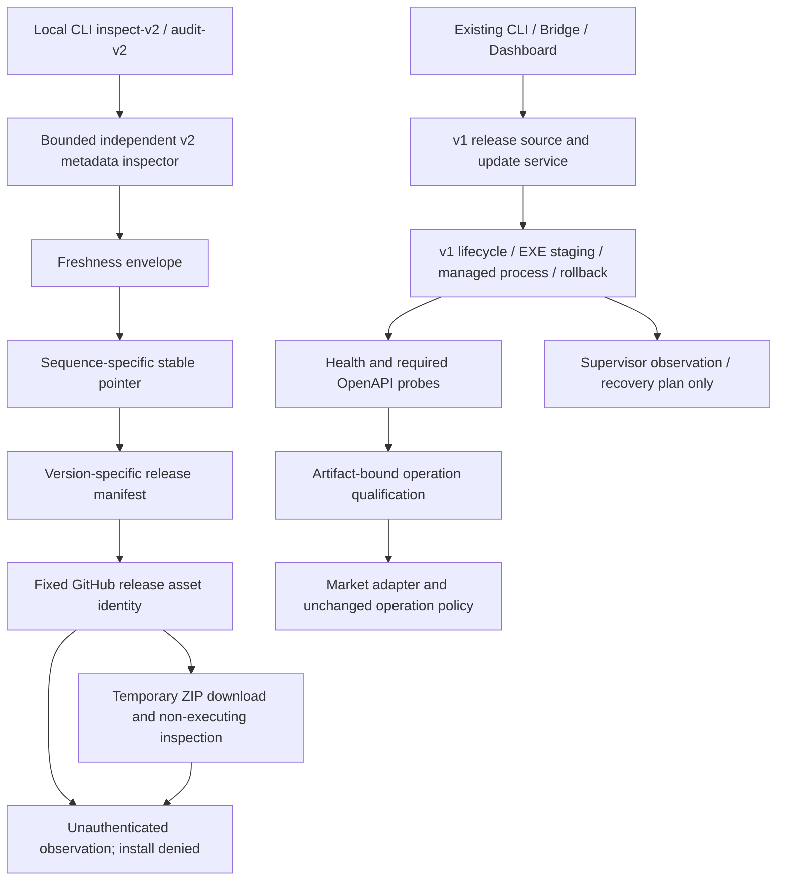

# FQGate v2 implementation handoff

2026-10-12. Deliverable: safe observation subset. **Full v2 compatibility and
installation remain BLOCKED; production update NOT EXECUTED.** PR stays open
while applicable runtime/signature/installation gates are unresolved.

## Upstream and trust result

PR #14 is verified MERGED, base commit
`40ad339d863391e8a746252581adbcee600a3fa0`. The 2026-10-12 observed official non-prerelease,
non-draft GitHub release is [2.0.4](https://github.com/fqgate/FQGate-releases/releases/tag/fqgate-v2.0.4),
published 2026-10-11 05:05:34 UTC. v1 stable remains 1.0.5. Investigation
pins upstream source commit `edb17da7fca0952534a65f4cfb98a62b6a017d43`.
The exact-byte public envelope fixtures preserve observed hash links.

No authoritative release public keys, signature algorithm/bytes contract or
rotation/revocation policy were found in release docs/tree or the agent tree.
64-byte signatures cannot establish an algorithm or trust root. The separate
MCP Apps signing system cannot authenticate FQGate executable releases.
Checksums establish internal consistency only. A coherent old sequence or a
forged signature still yields installAllowed false; there is no authenticated
persistent anti-rollback implementation. These blockers remain explicit output.

[Machine-readable matrix](../compatibility/fqgate-v1-v2.json) separates upstream,
automated and Windows evidence. Runtime wire changes remain unknown. Publisher
notes describe queue/rate and L2 degradation semantics; generic fixture health/
timeout tests are not real v2 runtime acceptance.

## Call-chain impact

| Module/caller                       | Result                                                                                     |
| ----------------------------------- | ------------------------------------------------------------------------------------------ |
| release v1 parser/source/downloader | Retained unchanged; 1.0.5 manifest still selected                                          |
| install/update/process/candidate    | Retained; no ZIP enters replaceExecutable or updater process                               |
| compatibility/evidence              | Retained; no v2 approval, range expansion or persisted evidence                            |
| health/openapi/market/QR            | Retained; v2 wire codes/fingerprints require actual evidence before adaptation             |
| Bridge/API/Dashboard                | No route, policy or version behavior change                                                |
| supervisor                          | No actuation; candidate restart IDs remain data                                            |
| v2-inspection.ts                    | New independent bounded fixed-source parser and linked-hash/asset comparison               |
| v2-archive.ts                       | New isolated download/read/cleanup with bounded ZIP/PE structural checks                   |
| CLI                                 | Two explicit local commands; configuration/application not constructed; exit 1 for BLOCKED |
| Windows observation script          | Permanent-checkout, secret-free read-only files/listeners/identity/metadata evidence       |

A full v2 installer would require a new directory transaction and recovery
adapter; it is not implemented. Transaction interruption/rollback-failure/process
identity deterministic tests cover the inherited v1 path only. All v2 activation,
process switching, L2/queue runtime and login semantics remain unqualified.

## Automated evidence and delivery identity

Local environment: WSL Linux, Node 24.19.0, repository-pinned pnpm 11.23.0.
Commands: `pnpm install --frozen-lockfile`, `pnpm typecheck`, `pnpm lint`,
`pnpm test`, `pnpm build`, `pnpm format:check`, `pnpm test:e2e`.
Complete test run before the freshness follow-up: 26 files / 384 tests, including 58 v2 tests; final receipt and exact commit
are recorded in the external delivery receipt and PR after final validation.
Browser run: 15 PASS, production-independent port 17283. Tests cover existing
context/operation matrix, IPv4 loopback, v1 qualification/rollback/process
identity and supervisor non-execution alongside the new v2 negatives.

Real Linux metadata/ZIP audit of 2.0.4 returned 9 entries / 58,360,814 bytes,
required PE headers PASS and cleanup REMOVED. No extraction or binary execution.
Metadata/asset hash agreement is not publisher signature verification.

Final exact-head Ubuntu/Windows run/job URLs, native Windows result, final
counts and commit are bound outside Git in
`D:\code\research\fqgate-v2-delivery-evidence.json` and the task PR. This avoids
altering the validated head merely to insert its own SHA into documentation.

## Permanent Windows and outstanding blockers

Use the existing `D:\code\research\fqgate-remote-bridge`; preserve the prior
branch/operator state. Read-only preflight found 17281 bound to 127.0.0.1;
17282 was absent and CIM executable path was unreadable at current privileges.
This is a current acceptance gap, not a reason to start/restart production.
Native final observation goes to
`D:\code\research\fqgate-v2-observation-evidence.json` with exact checkout SHA,
file hashes, listener identity classifications and explicit BLOCKED checks.
No claim of live v2 health/session/OpenAPI/lookup/queue/L2 acceptance is made.

Production update, downgrade, termination, restart, service install and Cloudflare
writes were not executed. Permission gaps, signature trust, directory transaction
and lack of an authorized isolated v2 runtime block full qualification. Even
explicit production-upgrade approval cannot remove those engineering gates.

[Operator procedure](../operations/windows-fqgate-v2-qualification.md) includes
exact observation commands, protected backup scope and stop conditions. There
is no safe v2 activation/rollback command to recommend yet. Keep 1.0.5 intact;
never adopt an unknown process or manufacture downtime for evidence. No
unrelated Phase 7-B2/7-C or product planning is included.

## Latest-source refresh — 2026-10-13

Continuation rechecked the publisher and found stable 2.0.5, published
2026-10-12T05:22:42Z. Source snapshot is
`1b56f62816b8347b871bc5a3f927148fae212eb9`: refreshSequence 9, sequence 8.
The 2.0.4 fixtures/evidence above remain historical. Added exact-byte 2.0.5
fixtures and one regression proving discovery follows the newer pointer while
installation and runtime qualification remain blocked. No protocol adapter or
production behavior changed. The latest Windows ZIP is 29,236,811 bytes,
SHA-256 `c64571e331ac7c23f425e4f5c9434cea850897bbb65a8888ebb3236f777df5ba`.
Public notes add CNEquity/calendar and source fallback features; they authorize
no new Bridge operation or automatic upstream installation.

The original commit `0a8aa5500d6f691cbfdfebc4d1d7e04f2f5d9c30` passed
[Ubuntu](https://github.com/blooddrunk/fqgate-remote-bridge/actions/runs/38201408821/job/114655414378)
and [Windows](https://github.com/blooddrunk/fqgate-remote-bridge/actions/runs/38201408821/job/114655414443).
Final follow-up head, CI and permanent-Windows evidence are bound in the external
receipt and [PR #15](https://github.com/blooddrunk/fqgate-remote-bridge/pull/15).
The PR remains open because full v2 qualification gates are unresolved.

## Permanent Windows results — 2026-10-13

Native Windows Node 24.20.0 / pnpm 11.23.0, permanent checkout on the original
implementation commit: frozen install, typecheck, lint, 26 files / 384 tests,
production build, format and both bootstrap/acceptance CLI smoke commands PASS.
The installed pnpm launcher was broken. Validation used the already-installed
11.23.0 `dist/pnpm.mjs` via Node and a repo-external `fqgate-v2-tools/pnpm.cmd`,
with process-local Windows PATH/PATHEXT. No global tool installation was modified.
Reproducible native runner and command/exit records:
`D:\code\research\fqgate-v2-run-validation.ps1`,
`D:\code\research\fqgate-v2-native-validation.json` and `.log`.

Real native Windows **non-executing** 2.0.5 ZIP audit PASS: 9 entries,
60,709,870 uncompressed bytes, required PE headers PASS, cleanup REMOVED.
This is archive evidence only. No v2 executable/updater was run. Current managed
file remains official 1.0.5, 23,707,648 bytes / known SHA-256; previous binary
is absent, so no usable production rollback artifact is claimed. No install lock
or transaction file was present. 17281 remains IPv4 loopback with PID 30284;
CIM could not prove its path and 17282 is absent. Full Windows acceptance stays
BLOCKED and production upgrade stays NOT EXECUTED.

A separate bounded read-only native current-runtime probe found health HTTP 200,
network ready, connected false, L2 unknown; OpenAPI 3.1.0 / 95 operations / 285,013
bytes with required base/lookup paths; fixed six-digit lookup HTTP 200 / code 0 /
one exact result. These are current 1.0.5 diagnostics, not v2 qualification or
Bridge/remote acceptance. Command/script and secret-free evidence:
`node D:\code\research\fqgate-v2-live-runtime.mjs` and
`D:\code\research\fqgate-v2-current-runtime-evidence.json`.
No QR/session login, process adoption or state write occurred.

The follow-up local suite is 26 files / 385 tests, including 59 v2 tests, and 15
browser E2E PASS. Final exact-head CI and Windows receipt are recorded externally
and in PR #15 after the freshness follow-up. The implementation itself is unchanged
from the original green head; the follow-up adds only public fixtures/test/docs.
